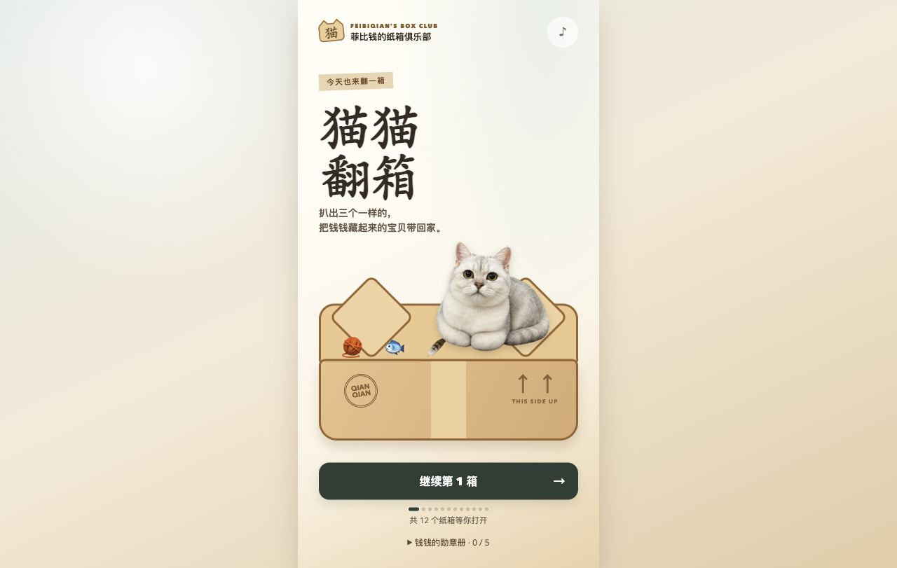
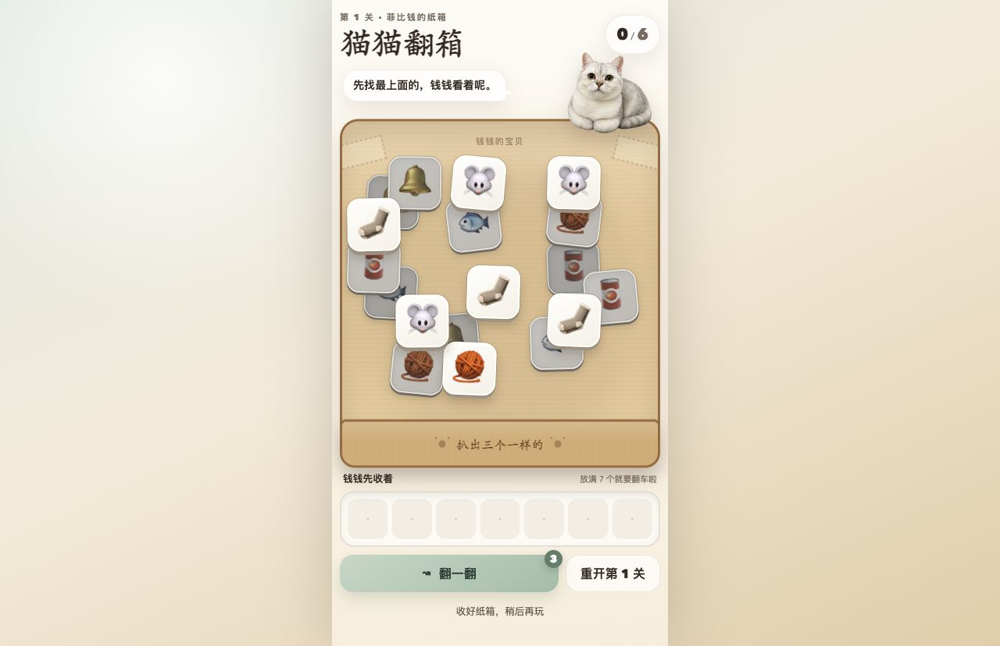

# 猫猫翻箱

**菲比钱的纸箱俱乐部 · 和一只银渐层猫咪一起找回纸箱里的小宝贝。**

一款面向手机浏览器的轻量消除小游戏：观察物品的遮挡关系，把三个相同物品凑在一起，陪钱钱打开十二只逐渐变难的纸箱。

## 在线试玩

### [试玩线上第 4 版 →](https://qianqian-box-game.right-teal-0434.chatgpt.site)

上面的链接可以直接进入已发布的游戏。本次 GitHub 备份同时保存了本地最新改进：新首页、本机续玩、连胜与勋章、音效等新增内容尚未发布到该试玩地址。

本 GitHub 页面用于作品介绍和收集反馈；下方截图与功能表介绍本次备份的本地最新版本。

个人项目：[@SofiaSu-27](https://github.com/SofiaSu-27)

## 本地最新版界面预览

首页：

游戏进行中：

## 怎么玩

1. 点击纸箱里没有被其他物品压住的宝贝，把它放进下方槽位。
2. 三个相同物品会自动消除；清空纸箱和槽位即可通关。
3. 槽位最多容纳七件物品，放满且无法凑成三个就会失败。
4. 遇到困难时，可以使用有限次数的“翻一翻”重新整理纸箱。

## 本次备份的本地最新版本

本地版本尚未另行发布为新的线上版本；续玩、勋章、音效及相关新界面目前仅包含在本次源码备份中。

| 内容 | 说明 |
| --- | --- |
| 十二只纸箱 | 物品数量与遮挡逐步增加；第十一、十二关没有“翻一翻”机会 |
| 猫咪陪伴 | 菲比钱会随消除、通关和失败切换动作与鼓励文案 |
| 阶段反馈 | 第五、七、九、十二关有专属鼓励；完成十二关后可以再开一轮 |
| 连胜与勋章 | 记录当前及最高连胜，解锁三连胜与阶段通关的五枚勋章 |
| 稍后再玩 | 收好纸箱回到首页，再次进入时继续当前棋盘 |
| 可选音效 | 首页可以开启或关闭游戏音效 |
| 本机进度 | 关卡、棋盘与勋章保存在当前浏览器，不做跨设备同步 |

## 设计想法

让消除游戏多一点角色陪伴和收藏感：纸箱、毛线球、小鱼干、纸质勋章与菲比钱的动作构成同一套视觉语言；首页、游戏中和通关页围绕“开箱”展开。

进度保存在本机，清理浏览器数据可能清除存档。游戏使用原生 HTML、CSS 和 JavaScript 实现；角色沿用菲比钱已有动画素材。

## 反馈与源码

欢迎通过本仓库的 Issues 反馈体验问题与建议，例如遮挡是否容易辨认、手机操作是否顺手、关卡难度是否合适。

本仓库公开作品介绍与截图。完整源码、角色素材和恢复说明另行保存在私有源码备份中。
